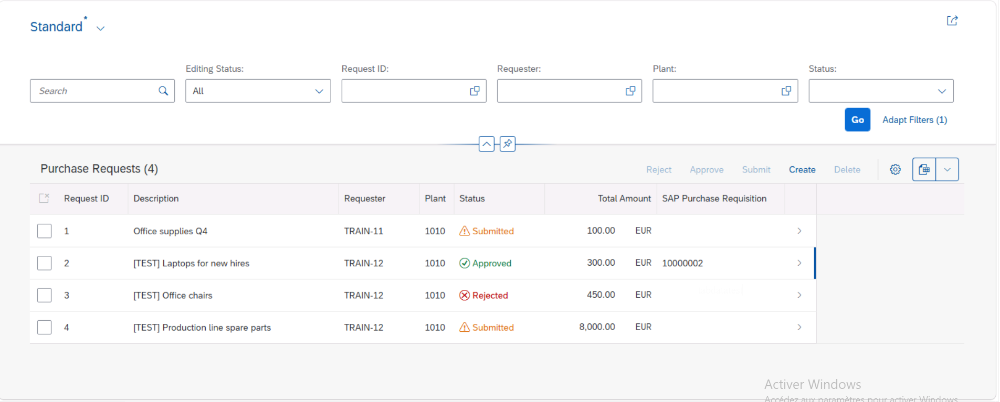
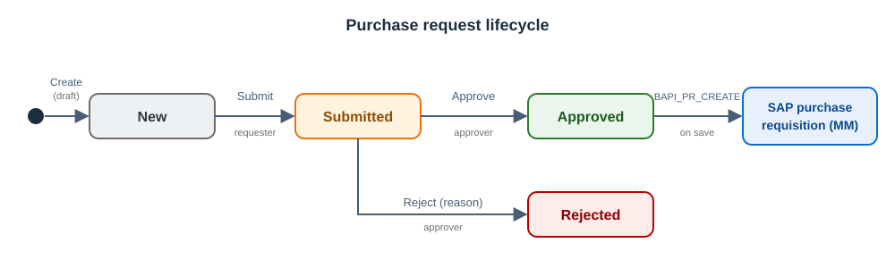
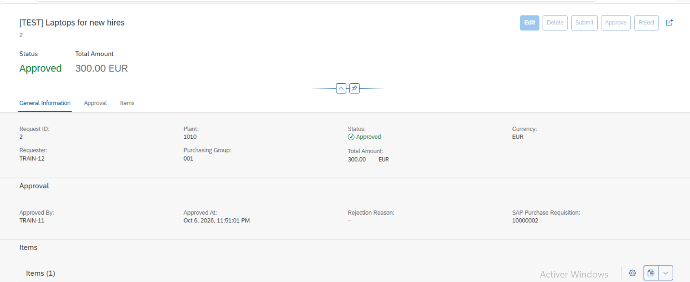
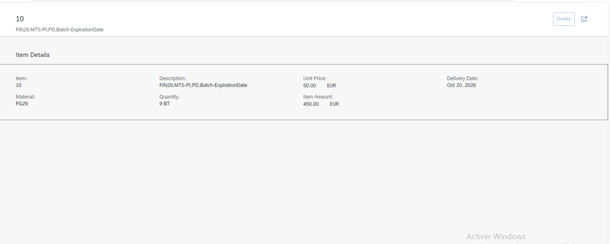
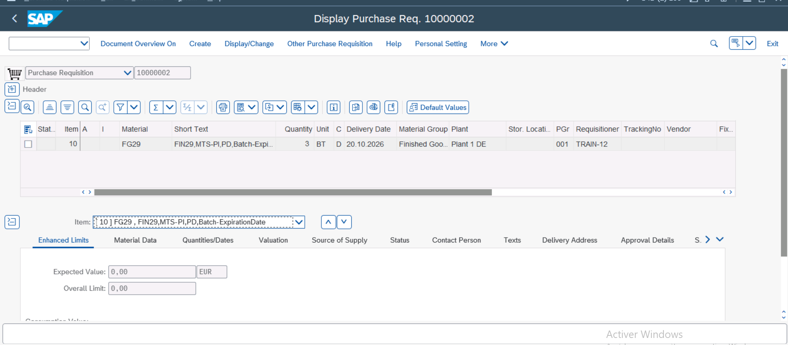
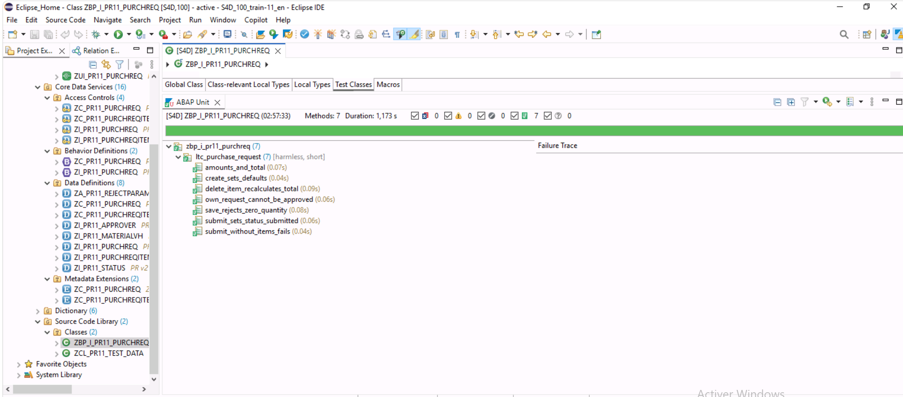
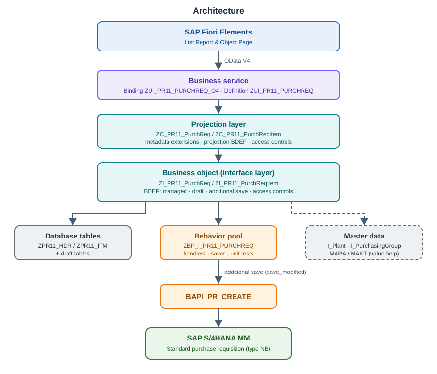
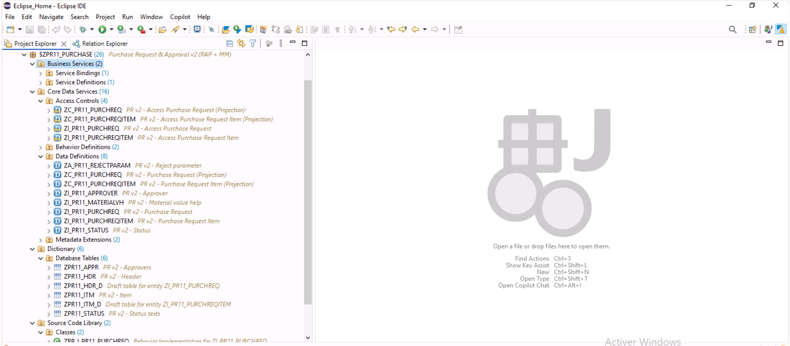

# SAP RAP Purchase Request & Approval – integrated with S/4HANA MM

A transactional **SAP Fiori Elements** application built with the **ABAP RESTful Application Programming Model (RAP)** on **SAP S/4HANA**.
Employees create purchase requests, approvers approve or reject them, and every approved request **automatically creates a standard SAP purchase requisition (MM)**.

---

## Business process

| Rule | Implementation |
|---|---|
| Only the requester can edit, delete or submit his request | Instance authorization |
| An approver can **never approve his own request** (segregation of duties) | Instance authorization |
| An approver can only approve up to his **approval limit** | Approvers table `ZPR11_APPR` + instance authorization |
| Edit, delete, submit, approve and reject depend on the status | Instance feature control (incl. the draft `Edit` action) |
| A request needs at least one item to be submitted | Action `submit` |
| A rejection requires a reason | Action `reject` with an abstract entity parameter |
| Requesters only see their own requests, approvers see all | CDS access control (DCL) |

---

## Screenshots

| Object page (approved request with SAP purchase requisition) | Item page |
|---|---|
|  |  |

| Purchase requisition created in MM (ME53N) | ABAP Unit – 7/7 tests passed |
|---|---|
|  |  |

---

## Architecture

---

## Technical highlights

**RAP business object**
- Managed BO with **draft** (root + composition child), strict mode, total ETag and optimistic locking.
- **Composite item key** (`PrUuid`, `ItemUuid`) with **early numbering**: item numbers 10, 20, 30… are assigned automatically. Because the parent key is part of the item key, the request total can be **recalculated after an item is deleted** (on delete, RAP only provides the key of the deleted instance).
- Determinations: initial values, request ID on save, item defaults from the material master (unit, description), amounts and total, **currency propagation** from header to items.
- Validations on header and items, with messages bound to fields and state areas for the draft.
- **Feature control** (what is possible in a given status) is kept separate from **authorization** (who is allowed to do it).

**Integration with SAP S/4HANA MM**
- On approval, a standard purchase requisition (type NB) is created with `BAPI_PR_CREATE`.
- The BAPI is called in the **save phase** through a **managed BO with additional save** (`save_modified`), the SAP pattern for integrating a classic API into a RAP transaction: the BAPI updates are committed together with the RAP data, without any `COMMIT WORK` in the business logic.
- The number of the SAP purchase requisition is stored on the request and displayed in the app.

**Security**
- CDS access controls (DCL) on interface and projection views, with inherited conditions for items.
- Instance authorization with segregation of duties and approval limits.

**UI**
- Fiori Elements annotations in metadata extensions: header data points, status texts with **criticality** (colors), field groups, line items with actions.
- Custom value help `ZI_PR11_MaterialVH` on MARA/MAKT (the standard `I_Product` is protected by an access control the user was not authorized for).

**Quality**
- **7 ABAP Unit tests** using EML against the BO, with an **ABAP SQL test double** (`cl_osql_test_environment`) for the approvers table. Nothing is committed: the transactional buffer is rolled back after each test.
- The tests revealed a real bug: when header and items are created in the **same EML request**, the order of the determinations is not guaranteed, and the item currency could stay empty. Fixed with the `propagateCurrency` determination.

| Test | Checks |
|---|---|
| `create_sets_defaults` | Status, requester, currency, item number, unit from the material master |
| `amounts_and_total` | Item amounts and request total |
| `delete_item_recalculates_total` | Total after deleting an item |
| `submit_without_items_fails` | No submission without items |
| `submit_sets_status_submitted` | Status after submission |
| `own_request_cannot_be_approved` | Segregation of duties |
| `save_rejects_zero_quantity` | Validation blocks the save |

---

## Development objects

| Type | Objects |
|---|---|
| Database tables | `ZPR11_HDR`, `ZPR11_ITM`, `ZPR11_HDR_D`, `ZPR11_ITM_D` (draft), `ZPR11_APPR` (approvers), `ZPR11_STATUS` (status texts) |
| CDS interface views | `ZI_PR11_PurchReq`, `ZI_PR11_PurchReqItem`, `ZI_PR11_Approver`, `ZI_PR11_Status`, `ZI_PR11_MaterialVH` |
| CDS projection views | `ZC_PR11_PurchReq`, `ZC_PR11_PurchReqItem` |
| Abstract entity | `ZA_PR11_RejectParam` (action parameter) |
| Metadata extensions | `ZC_PR11_PURCHREQ`, `ZC_PR11_PURCHREQITEM` |
| Access controls | `ZI_PR11_PURCHREQ`, `ZI_PR11_PURCHREQITEM`, `ZC_PR11_PURCHREQ`, `ZC_PR11_PURCHREQITEM` |
| Behavior definitions | `ZI_PR11_PURCHREQ` (managed, draft, additional save), `ZC_PR11_PURCHREQ` (projection) |
| Classes | `ZBP_I_PR11_PURCHREQ` (handlers, saver, unit tests), `ZCL_PR11_TEST_DATA` (test data generator) |
| Business services | `ZUI_PR11_PURCHREQ` (service definition), `ZUI_PR11_PURCHREQ_O4` (OData V4 UI binding) |

---

## Environment

- SAP S/4HANA 2021 
- ABAP Development Tools for Eclipse
- ABAP language version: **Standard ABAP**. On S/4HANA 2021 on-premise, the *ABAP for Cloud Development* language version is not available for customer objects, which is also why a classic BAPI is used for the MM integration.

## Installation

1. Create a package and import this repository with **abapGit** (offline: *New Offline* → *Import ZIP*, or online).
2. Activate all objects.
3. Publish the service group `ZUI_PR11_PURCHREQ_O4` with transaction `/IWFND/V4_ADMIN` (system alias `LOCAL`).
4. Run `ZCL_PR11_TEST_DATA` (F9 in ADT): it fills the status texts, registers the current user as approver (limit 5,000 EUR) and creates submitted test requests of another user.
5. Open the service binding in ADT and start the **Fiori Elements preview**.

The test data uses material `FG29`, plant `1010` and purchasing group `001`; adapt these constants to your system.

---

## Possible improvements

- Number range object instead of `MAX + 1` for the request ID.
- Message class instead of text messages (translation).
- Currency conversion for approval limits in other currencies.
- Multi-level approval depending on the amount (e.g. with SAP Build Process Automation).
- On SAP S/4HANA 2022 or later: ABAP Cloud version using the released RAP BO `I_PurchaseRequisitionTP` instead of the BAPI (clean core).

---

## Author

**Yassine ZOUGUARI** – Engineering student in Information Systems Management & Governance (ENSIASD Taroudant), SAP Certified – ABAP Cloud (C_ABAPD_2601).
[GitHub](https://github.com/Zouguari)
